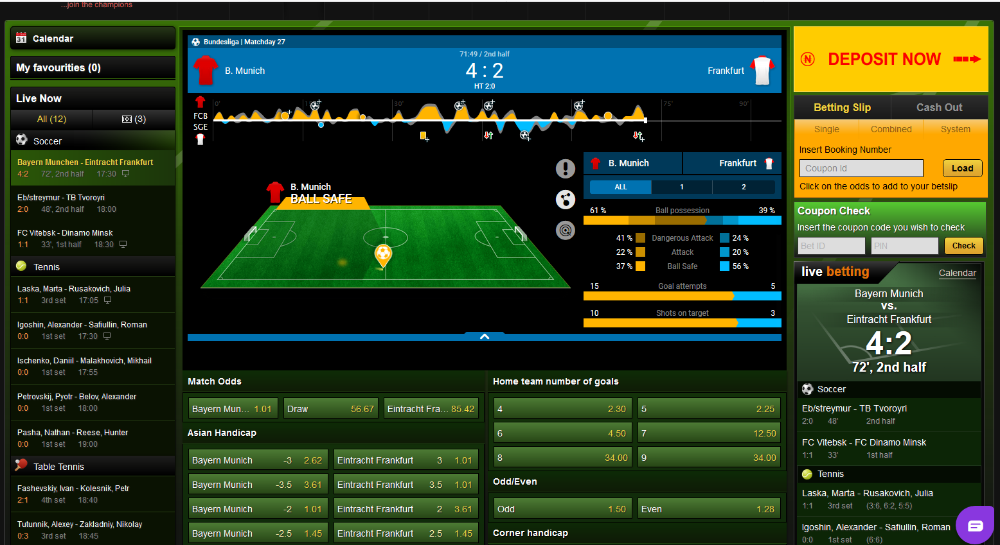

# Cartrify — the sportsbook platform behind NaijaBet

**White-label sportsbook infrastructure for licensed operators in Africa. Live in three weeks.
Fixed monthly fee. No revenue share — the operator keeps 100% of GGR.**

[cartrify.com](https://cartrify.com) · [info@cartrify.com](mailto:info@cartrify.com) · +1 (973) 671-8622

> **This repository is documentation and a UI preview — it is not the platform source.**
> Cartrify licences a running, hosted, supported platform. See
> [What we do and don't sell](#what-we-do-and-dont-sell).

---

## It is already running a real book

The platform powers **NaijaBet**, a licensed Nigerian sportsbook operating today: real players,
real deposits, real settlement, mobile-money rails, agent network, and a regulator watching.

That is the difference worth checking before you sign with anyone. Most platforms in this market
show a demo. This one has a profit-and-loss statement.

| | |
|---|---|
| **Sports** | Football, basketball, tennis, table tennis, MMA/UFC, esports, and more |
| **Markets** | Pre-match and live, cash out, bet builder, booking codes, special bets you create yourself |
| **Odds** | Your choice of feed — LSports, SportsRadar, Betradar, Kambi — or our compilation add-on |
| **Payments** | M-Pesa, MTN MoMo, Airtel Money, Paystack, OPay, Budpay, Moniepoint, Palmpay; a new gateway in 24 hours |
| **Agents** | Agent and cashier network, float management, per-agent dashboard |
| **Players** | KYC states, limits and risk controls, wallet and ledger, full audit trail |
| **Casino** | Provably fair games, plus Africa-themed titles built for this market |
| **AI operations** | Analytics, retention, engagement and support agents — bring your own model key if you prefer |
| **Compliance** | Licensing support and multi-jurisdiction regulatory reporting |
| **Brand** | Your domain, your UI. Premium domains available (malibet.com, ghanabet.com and others) |

---

## Commercials, in one paragraph

A **fixed monthly fee from ₦5M**, priced in your local currency or paid in USDT/BTC/ETH/USDC.
**No revenue share, ever.** The fee does not rise as your book grows, which is the entire point:
on a percentage model the platform earns more every time you succeed at acquisition. Setup is
quoted per deployment — brand, domain, integrations, data migration — before any work starts.

If your platform currently takes a share of GGR, the arithmetic is worth doing on your own numbers
before anything else: send us three months of GGR and we will put it in writing.

---

## Three weeks, start to live

| Week | What happens |
|---|---|
| **1** | Brand, domain and UI direction. Payment accounts connected. Licence documentation reviewed. Migration plan if you are moving off another platform. |
| **2** | Markets and odds feed live in staging. Casino, agent network and wallet configured. Your team trained on the admin panel. |
| **3** | User acceptance testing with your staff, compliance checks, go-live. |

Moving platforms is a migration, not a shutdown: both run in parallel through the cutover, so no
player is lost in the switch.

---

## What we do and don't sell

**We do sell:** a white-label licence to a platform that is running a live licensed book — hosted,
maintained, supported and updated, launched under your brand.

**We do not sell:** source code. Not as a package, not as a download, not in this repository.

The reason is not secrecy for its own sake. The same codebase runs a book that handles real money
under a gaming licence; handing it out would hand over player funds' safety, our licence posture
and our own operators' edge. If source access matters to you, that is an Enterprise conversation
with escrow terms — not a repository.

---

## Repository contents

- [`docs/integration-guide.md`](docs/integration-guide.md) — what an operator actually needs in
  place to go live: licence, payment rails, odds feed, KYC/AML, agent network.
- [`index.html`](index.html) — a static UI preview of the betting interface, published at
  **https://upsideway.github.io/cartrify-sportsbook-platform/** . Sample fixtures, no live data, no
  backend.
- [`assets/`](assets) — screenshots of the production platform.

---

## Talk to us

Email **[info@cartrify.com](mailto:info@cartrify.com)** or use the form at
[cartrify.com/contact](https://cartrify.com/contact).

Tell us three things and we will tell you honestly whether we fit:

1. Licence status — held, in application, or still to be arranged.
2. Current setup — own platform, white-label, or not launched yet.
3. Monthly GGR and your target go-live date.

Cartrify is operated by **Kreativ Management Inc.** · 55 Madison Ave, Morristown, New Jersey ·
Malta · Lagos, Nigeria.

*No source code is published in this repository. Content and screenshots © Kreativ Management Inc.*
